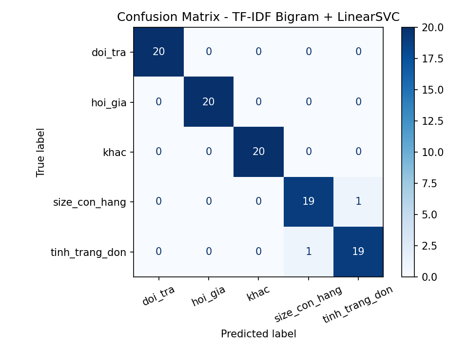

# Phân Loại Ý Định Câu Hỏi Khách Hàng Shop Online (Tiếng Việt)

Đề tài cuối kỳ học phần **Học máy cơ bản** — xây dựng mô hình học máy phân loại ý định (Intent Classification) từ câu hỏi tiếng Việt của khách hàng shop online vào 5 nhóm, phục vụ bài toán chatbot chăm sóc khách hàng.

---

## 1. Bài toán & 5 nhóm ý định

| Mã nhãn | Ý định | Ví dụ |
| --- | --- | --- |
| `hoi_gia` | Hỏi giá | *"áo hoodie bên shop giá thế nào ạ?"*, *"ao nay bn z shop"* |
| `tinh_trang_don` | Hỏi tình trạng đơn | *"minh muon tra cuu don md92521"*, *"sao don minh chua giao vay shop"* |
| `doi_tra` | Đổi / trả hàng | *"áo khoác mặc không vừa, đổi được không?"*, *"mac ko vua doi sz dc ko"* |
| `size_con_hang` | Hỏi size / còn hàng | *"dép này có size L không ạ?"*, *"túi xách màu trắng còn hàng ko bạn?"* |
| `khac` | Khác (chào hỏi, cảm ơn...) | *"Hàng đẹp quá, cảm ơn shop nhiều"*, *"Ok mình hiểu rồi"* |

**Dữ liệu ([data.csv](data.csv)):** 500 câu hỏi cân bằng tuyệt đối (100 câu / nhóm), bao gồm cả câu tiếng Việt không dấu (~19.8%), viết tắt/teencode (`ko`, `mik`, `dc`, `bn`, `sz`, `z`...) và mã đơn hàng (`SP32365`, `md92521`...).

---

## 2. Cấu trúc dự án

```text
IntentClassification_KhachHang_Shop/
├── data.csv                 # Bộ dữ liệu 500 câu hỏi (2 cột: cau_hoi, nhan)
├── preprocess.py            # Tiền xử lý văn bản (chữ thường, mã đơn -> ma_don, bỏ dấu câu, chuẩn hóa viết tắt)
├── compare_models.py        # So sánh 16 tổ hợp (BoW/TF-IDF x Unigram/Bigram x NB/SVM Linear/SVM RBF/Decision Tree) + GridSearchCV
├── train_model.py           # Huấn luyện mô hình tốt nhất, in TP/FP/FN, vẽ Confusion Matrix, lọc câu sai và lưu model
├── demo.py                  # Chương trình Demo CLI nhập câu hỏi -> in nhãn dự đoán & độ tin cậy (%)
├── intent_model.joblib      # Mô hình đã huấn luyện sẵn (TF-IDF Bigram + Calibrated LinearSVC)
├── confusion_matrix.png     # Ma trận nhầm lẫn trên tập Test (100 câu)
├── requirements.txt         # Danh sách thư viện cần thiết
└── docs/                    # Slide bài giảng & tài liệu tham khảo
```

---

## 3. Cài đặt & Hướng dẫn chạy

### Cài đặt thư viện
```bash
pip install -r requirements.txt
```

### Chạy từng bước
1. **Kiểm tra hàm tiền xử lý:**
   ```bash
   python preprocess.py
   ```
2. **Chạy thử nghiệm so sánh 16 tổ hợp mô hình & GridSearchCV:**
   ```bash
   python compare_models.py
   ```
3. **Huấn luyện mô hình cuối cùng, xuất `confusion_matrix.png` và lưu `intent_model.joblib`:**
   ```bash
   python train_model.py
   ```
4. **Chạy chương trình Demo backend:**
   ```bash
   python demo.py
   ```

---

## 4. Kết quả thực nghiệm

Dữ liệu được chia **80% Train (400 câu) / 20% Test (100 câu)** có `stratify=y`, `random_state=42`. Kết quả tiêu biểu của các thuật toán:

| Đặc trưng | Thuật toán | Train Accuracy | Test Accuracy | Macro F1 |
| --- | --- | ---: | ---: | ---: |
| **TF-IDF Bigram (1,2)** | **SVM Linear (`LinearSVC`)** | **1.0000** | **0.9800** | **0.9800** |
| BoW Unigram (1,1) | SVM RBF (`SVC`) | 0.9975 | 0.9600 | 0.9604 |
| TF-IDF Bigram (1,2) | Naive Bayes (`MultinomialNB`) | 0.9975 | 0.9200 | 0.9196 |
| TF-IDF Bigram (1,2) | Decision Tree (`criterion="entropy"`, `max_depth=10`) | 0.9075 | 0.9000 | 0.9036 |

### Ma trận nhầm lẫn (TF-IDF Bigram + LinearSVC — Accuracy 98%)



---

## 5. Ví dụ chạy Demo (`demo.py`)

```text
Nhập câu hỏi: don AB12345 giao toi dau r

---------- KẾT QUẢ DỰ ĐOÁN ----------
Câu hỏi gốc: don AB12345 giao toi dau r
Câu sau tiền xử lý: don ma_don giao toi dau rồi
Ý định dự đoán: Hỏi tình trạng đơn
Độ tin cậy: 94.81%
--------------------------------------
```
